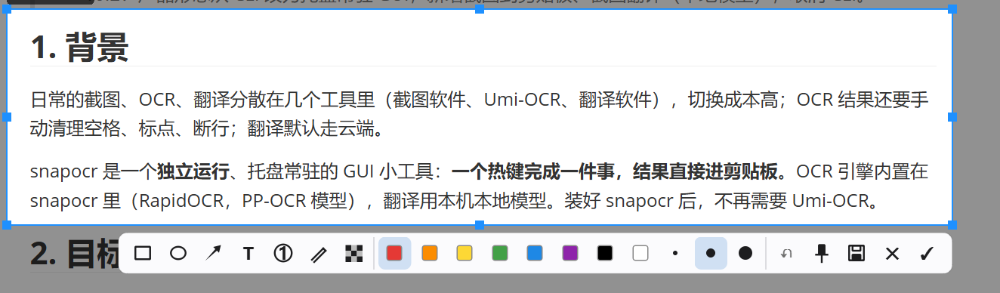
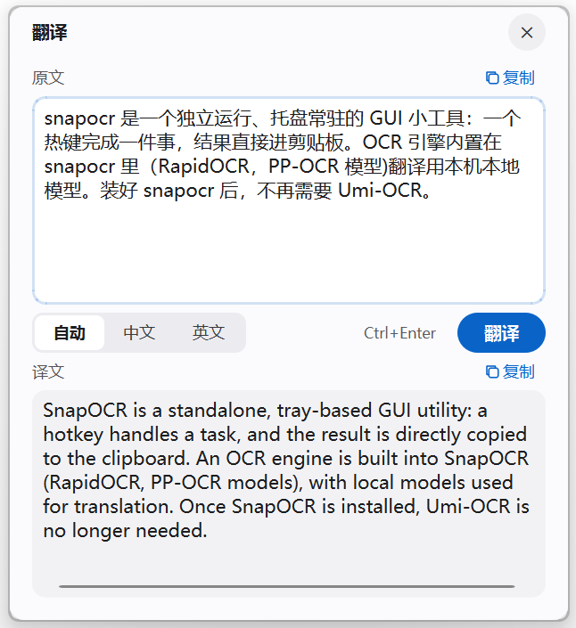
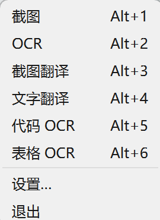

# snapocr

[中文说明](README.zh-CN.md)

A tray-resident screenshot tool for Windows: **one hotkey, one job, result on the clipboard.** Capture a region, OCR it, or translate it — fully local. OCR runs in-process (RapidOCR / PP-OCR models); translation uses a model server on your own machine (Ollama by default). snapocr only ever talks to `127.0.0.1`.

This is the first piece of software I (Jeremy) built by working with an AI coding assistant ([Claude Code](https://claude.com/claude-code)), test-first from the start.

> The user interface is in **Chinese only** for now.

## Screenshots

| Annotate a screenshot (`Alt+1`) | Translation window (`Alt+3` / `Alt+4`) | Tray menu |
|---|---|---|
|  |  |  |

## Features

| Hotkey | What it does |
|---|---|
| `Alt+1` | Screenshot → clipboard. Before copying you can annotate (rectangle, ellipse, arrow, text, numbered markers, pen, mosaic, undo), pin the shot on screen, or save it as a file |
| `Alt+2` | Screenshot → OCR → cleaned-up text on the clipboard (spacing, punctuation, line joins for Chinese / English) |
| `Alt+3` | Screenshot → OCR → translation window (Chinese ⇄ English); the translation goes to the clipboard, and you can fix the recognized text and translate again |
| `Alt+4` | Translation window for typed or pasted text |
| `Alt+5` | Code OCR: keeps indentation |
| `Alt+6` | Table OCR: pastes as a table into Excel / Word (HTML) and as Markdown into editors |

All hotkeys can be changed in **Settings** (tray menu → 设置…), together with start-with-Windows, the translation model, the save folder and the window style (light / dark glass, light solid, or follow Windows). Multiple monitors with different scaling are supported.

## Requirements

- Windows 11 (64-bit). Windows 10 should work but is untested; the glass window style needs Windows 11 and falls back to a solid style elsewhere.
- Python **3.12** (exactly; 3.13 is not supported yet).
- For translation only: [Ollama](https://ollama.com/) (or any OpenAI-compatible server on `127.0.0.1`, such as LM Studio or llama.cpp server). Screenshot and OCR work without it.
- About 500 MB of disk space for the Python packages (Qt, OpenCV, ONNX Runtime). The OCR models come with the `rapidocr` package — nothing is downloaded at run time.

## Install

With [uv](https://docs.astral.sh/uv/) (recommended):

```powershell
uv tool install --python 3.12 git+https://github.com/Jeremy-creater/snapocr
uv tool update-shell   # once, so that `snapocr` is on PATH (open a new terminal afterwards)
snapocr
```

Or with pip, into a virtual environment:

```powershell
py -3.12 -m venv %USERPROFILE%\snapocr-env
%USERPROFILE%\snapocr-env\Scripts\python.exe -m pip install git+https://github.com/Jeremy-creater/snapocr
%USERPROFILE%\snapocr-env\Scripts\snapocr.exe
```

`snapocr` starts without a console window; look for its icon in the tray. Only one instance runs at a time. To start it with Windows, tick 开机自启动 in Settings.

## Set up translation (optional)

1. Install and start [Ollama](https://ollama.com/).
2. Get a translation model. snapocr's default is `hy-mt2:7b`, Tencent's HY-MT2-7B translation model (GGUF) imported with the Modelfile in this repository:
   ```powershell
   # edit the FROM line in docs/hy-mt2-7b.Modelfile to point at your .gguf file, then:
   ollama create hy-mt2:7b -f docs/hy-mt2-7b.Modelfile
   ```
   Any other chat model in Ollama works as well, for example `ollama pull qwen2.5:7b`; then pick it in Settings (翻译模型) or set `model` in the config file.
3. Models have their own licenses. Read the license of the model you choose before downloading it.

If Ollama is not running, snapocr says so in the translation window; OCR and screenshots keep working.

## Configuration and files

| What | Where |
|---|---|
| Config file | `%APPDATA%\snapocr\config.toml`, created with comments on first start. Most options are in the Settings window; the rest are in this file (restart after editing it) |
| Logs and debug output | `%LOCALAPPDATA%\snapocr` |

Overrides: `snapocr --config PATH`, or the environment variables `SNAPOCR_CONFIG` (config file) and `SNAPOCR_RUNTIME_DIR` (an absolute folder for logs and debug output).

## Privacy

- Everything runs on your computer. OCR runs inside snapocr, offline. Translation requests go only to `http://127.0.0.1:<port>`; other addresses and Ollama cloud models are refused.
- Screenshots and recognized text stay in memory. Nothing is written to disk unless you click Save, or turn on debug mode (`[debug] enabled = true`), which writes each screenshot and its text into the `debug` folder under the logs folder.
- Logs never contain recognized text.

## Development

The requirements live in [`docs/PRD.md`](docs/PRD.md) and the working rules in [`CLAUDE.md`](CLAUDE.md) (both in Chinese). The project was developed test-first with Claude Code and the tdd-guardian plugin; plans and recaps for each milestone are in `.claude/tdd-guardian/`.

```powershell
git clone https://github.com/Jeremy-creater/snapocr
cd snapocr
uv venv --python 3.12
.venv\Scripts\Activate.ps1
uv pip install -e ".[dev]"
```

Tests are split into lanes:

| Lane | Command | Needs |
|---|---|---|
| unit | `python -m pytest -m "not integration and not engine and not perf and not gui"` | nothing (Qt runs offscreen) |
| engine | `python -m pytest -m "engine and not perf and not gui"` | the real OCR models (installed with `rapidocr`) |
| gui | `python -m pytest -m "gui and not perf" --qt-desktop` | a real Windows desktop; registers test hotkeys and touches the clipboard |
| integration | `python -m pytest -m "integration and not perf"` | Ollama running with the configured model |

CI runs the unit and engine lanes on Windows.

## License

[MIT](LICENSE). Third-party components and their licenses: [THIRD_PARTY_NOTICES.md](THIRD_PARTY_NOTICES.md).
